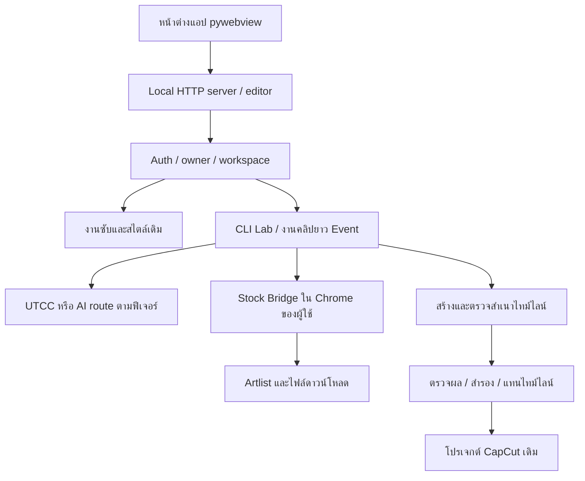

# โครงสร้างและแบบระบบ — ช่วยด้วยจ้า

อัปเดต: 5 พฤศจิกายน 2026 · ซอร์ส/Release สาธารณะ: **1.5.70** · แอปที่ติดตั้งตรวจแยกจากซอร์ส

เอกสารนี้อธิบายระบบที่มีอยู่จริงและหลักการที่ต้องรักษา อ่านคู่กับ `TASK_PHASES.md` ก่อนเริ่มงาน หากโค้ดไม่ตรงเอกสาร ให้ตรวจหลักฐานและแก้เอกสารในงานเดียวกัน ไม่ใช้เอกสารเก่าเป็นข้อยืนยันว่าฟังก์ชันยังใช้ได้

## 1. เป้าหมายผลิตภัณฑ์

แอปเดสก์ท็อปสำหรับผู้ใช้ทั่วไป ช่วยจัดซับและสไตล์ ตัดเรื่องจากคลิปยาว/หลายคลิป เพิ่ม B-roll เพลง และ Super Text แล้วนำผลกลับเข้าโปรเจกต์ CapCut เดิมอย่างกู้คืนได้ ผู้ใช้ควรทำงานผ่านแอปได้เอง ไม่ต้องเปิด Codex ในการใช้งานประจำ

เส้นทางหลัก: เลือกโปรเจกต์ → ใช้ Auto Caption ของ CapCut → เลือกรูปแบบ/ความยาว → วางแผน → ตรวจเรื่อง → สร้างผล → บันทึกและกลับหน้าหลัก CapCut → ใช้ผลกับโปรเจกต์เดิม → ตรวจภาพ/เสียงก่อนส่งออก

หลักด้านงานตัดต่อ: ยึดคำพูดจริง ซับสั้นหนึ่งบรรทัดเมื่อเหมาะสม ใช้ DB Heavent Blk และสไตล์/สีคณะจากระบบเดิม ซูมต่อเนื่องข้ามรอยตัด ภาพประกอบตรงประเด็น ไม่ซ้ำโดยไม่จำเป็น เพลงเข้ากับเนื้อหาและยาวครอบคลุมคลิป ไม่เปิดภาพคนพูดซ้อน B-roll โดยอัตโนมัติ เว้นแต่ผู้ใช้เลือก

## 2. สถาปัตยกรรม

เซิร์ฟเวอร์ฟังที่ `127.0.0.1` เริ่มพอร์ต 8765; ตัวเปิดแอปเลือกพอร์ตว่างได้ อย่าฝังพอร์ตเดียวในระบบเชื่อมต่อ และอย่าเปิดบริการออกเครือข่ายโดยไม่ออกแบบสิทธิ์เพิ่ม

| ส่วน | จุดเริ่มอ่าน/แก้ | หน้าที่ |
|---|---|---|
| เปิดแอป | `app/app_shell.py`, `app/ks/app_instance.py` | pywebview, backend, instance lock, self-test |
| โหมดเว็บ | `app/run.py`, `app/ks/server.py` | HTTP API, bind ผู้ใช้/โปรเจกต์, dispatch งาน |
| หน้าจอ | `app/ks/pages.py`, `editor_page.html`, `*_ui.py` | ประกอบ UI เดิมและแท็บเพิ่มเติม |
| สิทธิ์และ config | `auth.py`, `ce_config.py`, `ai_router.py` | ผู้ใช้, workspace, config และ route แยกฟีเจอร์ |
| ระบบเดิม | `core_engine.py`, `ce_features.py`, `ce_project.py`, `ce_timing.py` | ซับ สไตล์ โปรเจกต์ และ API ที่โค้ดเดิมเรียก |
| วางแผน/สร้างคลิป | `cli_lab.py`, `cli_lab_story.py`, `cli_lab_planning.py` | อ่านซับจริง ตรวจแผน จัดหลายช่วง และสร้างผลผ่าน CLI |

| งานคลิปยาว/Event | `event_clip.py`, `event_jobs.py`, `event_timeline.py` | วิเคราะห์หัวข้อ ช่วงผู้พูดที่กำหนด และแผนคลิปสั้น |
| Multicam/เสียง | `cli_lab_nested.py`, `cli_lab_alignment.py` | อ่าน draft ซ้อน สร้างเสียงสำหรับ align ซับเดิม |
| คำพูด/ซับ | `caption_roles.py`, `caption_resegment.py`, `text_layout.py` | แยกบทพูดจาก overlay และจัดท่อน/บรรทัด |
| งานภาพและข้อความ | `cli_lab_brand_style.py`, `cli_lab_typography.py`, `caption_style.py`, `timeline_motion.py`, `cli_lab_social.py`, `cli_lab_presentation.py` | สไตล์ร่วม ซูม keyframe ข้อความเน้นและจังหวะภาพ |
| B-roll ปกติ/เพิ่มภาพเท่านั้น | `broll.py`, `broll_auto.py`, `broll_auto_ui.py` | คงคำค้น/ลิงก์เดิม เพิ่มเส้นทาง Artlist แบบ add-only ในซอร์ส P1.4 |
| คลังสื่อ | `stock_accounts.py`, `stock_browser.py`, `stock_media.py`, `stock_project.py`, `stock_polish.py` | งานบัญชี/ดาวน์โหลด ตรวจไฟล์ จัดลงคลิป และปลายทางตามโปรเจกต์ |
| ส่วนขยาย | `app/stock_extension/` | Chrome Manifest V3; ทำงานบนเว็บที่ผู้ใช้ล็อกอิน |
| ระดับเสียง | `audio_levels.py`, `stock_polish.py` | วัด sample peak dBFS, เสียงพูดเป้าหมาย −4 และเพลง −18; ไม่ใช่ค่า fader หรือ LUFS |
| Webhook | `ce_ai.py`, `cli_lab_webhook.py`, `webhook_diagnostics.py` | เรียก AI รอผล/ยกเลิก และเก็บข้อมูลวินิจฉัยที่ไม่รวมเนื้อหา |
| งานเบื้องหลัง | `job_store.py`, `job_admission.py`, `feature_tasks.py`, `cli_progress_ui.py` | receipt แยกเจ้าของ งานชนกัน สถานะและ recovery |
| เขียน CapCut | `cli_lab_commit.py`, `apply_guard.py`, `capcut_session.py`, `unified_history.py` | ตรวจต้นทาง/สื่อ ล็อก สำรอง mirror rollback และประวัติ |
| แพ็ก/อัปเดต | `karaoke_studio_app.spec`, `release_package.py`, `publish_release.py`, `ks/updater.py`, `version.json` | runtime ฝังในแอป ZIP/hash GitHub และติดตั้งแทนตัวเดิม |
| เก็บไฟล์เก่า | `ks/storage_manager.py` | ตรวจสิ่งอ้างอิงและ cleanup ที่ย้อนกลับได้ |

ชื่อไฟล์ในตารางที่ไม่ขึ้นต้น `app/` อยู่ใต้ `app/ks/` ยกเว้นไฟล์แพ็ก/Release ซึ่งอยู่ใต้ `app/`

ตัวตรวจรอยต่อใน `cli_lab_planning.py` ปฏิเสธกรณีที่พบแน่ชัดว่าซับต่อประโยคหรือเกริ่นรายการสามคำถามแล้วเลือกมาไม่ครบ โดยให้ AI จัดแผนใหม่ `cli_highlight_coherence.py` ให้ AI อิสระตรวจว่าช่วงเปิด กลาง และจบเล่าเรื่องเดียวกันก่อนยอมรับแผนไฮไลต์ยาวตั้งแต่ 45 วินาที; ผลอนุมัติต้องมีคำพูดจริงยืนยันทุกช่วง แม้มีแผนเดียว ถ้าไม่ผ่านจะใช้รอบซ่อมแผนที่มีอยู่ ตัวตรวจเหล่านี้เป็น guard เฉพาะรูปแบบที่ตรวจได้ ไม่ใช่การรับรองคุณภาพเชิงความหมายทุกกรณี และอาจยังจบด้วยสถานะต้องตรวจเมื่อซ่อมไม่สำเร็จ

ข้อควรระวังในการ import: `core_engine.py` re-export โมดูลแบบไม่ใส่ `ks.` เพื่อรองรับโค้ดเดิม การเพิ่ม import ต้องไม่สร้าง config/state สองชุด ชุด self-test ตรวจ `core_engine.STATE is ce_config.STATE`

## 3. ข้อมูลและขอบเขตการเขียน

| ตำแหน่ง | ประเภท | ข้อปฏิบัติ |
|---|---|---|
| `app/ks/`, `app/stock_extension/`, `app/tests/` | ซอร์ส/ทดสอบ | แก้จากที่นี่ ไม่แก้ในไฟล์แอปที่ build แล้ว |
| `app/tools/` | Node, CapCut CLI, media runtime | dependency ที่แพ็กไปด้วย ไม่แก้ vendored code โดยไม่มีเหตุผลและหลักฐาน |
| `app/dist-*`, `app/build-*` | ผล build | สร้างใหม่ได้ เก็บเพียง 5 เวอร์ชันล่าสุดตามคำขอผู้ใช้ |
| `audits/` | หลักฐานทดสอบ/บางส่วนเป็นผลตัดต่อ | อ่านรายงานได้ ห้ามลบทั้งโฟลเดอร์เพียงเพราะเก่า; สื่ออาจยังถูกอ้างอิง |
| `media_library/` | สื่อในเครื่อง | อย่าลบหรือย้ายโดยไม่ตรวจการอ้างอิง |
| `~/.karaoke_studio/` | ข้อมูลผู้ใช้/เครื่อง | config, keys, sessions, stock pairing, receipts และ outputs; ห้ามใส่ Git หรือ Release |
| โปรเจกต์ CapCut ที่ผู้ใช้เลือก | งานจริงภายนอกซอร์ส | เขียนผ่าน guard/backup/transaction เท่านั้น |
| `release_repository/` | Git สำหรับข้อมูลอัปเดต | ณ วันที่บันทึก Git ติดตามเฉพาะ `version.json`; ไม่ใช่ที่เก็บซอร์สแอปทั้งหมด |
| `motion-intro/`, `test-mcp-0.1/` | งาน/ทดลองแยก | ไม่ใช่ backend หลัก อ่านคำสั่งเฉพาะโฟลเดอร์ก่อนแตะ |

receipt แยกตาม hash ของเจ้าของและชนิดงาน (`cli`, `event`, `stock`, `plans`, `installs`, `results`) งานที่โปรเซสเก่าหยุดกลางทางไม่ควรถูกเริ่มเขียนต่อเอง ข้อมูลลับใช้กลไกไฟล์ส่วนตัวเดิม ไม่ฝัง credential ของผู้พัฒนาในแอปแจก

## 4. สัญญาระหว่างขั้นตอน

### 4.1 วางแผน

- CLI Lab ยึดซับพร้อมเวลาของ CapCut ไม่สร้างบทถอดเสียงใหม่แทนที่โดยเงียบ ๆ
- โหมดจัดเรื่องรับความยาวเป้าหมาย 5–600 วินาที ตาม `cli_lab_limits.py`; ไม่ได้หมายความว่าต้นฉบับยาวได้เพียง 10 นาที
- โหมดหลายช่วงตรวจช่วงซับจริง ความยาวรวม การซ้อน และ coverage ของแหล่งต้นฉบับ มีการขอปรับแผนเมื่อ validation ไม่ผ่าน
- แผนก่อนสร้างผลยังมีอายุ 1 ชั่วโมงและผูกกับ hash ต้นทางใน `cli_lab.py` อย่าสับสนกับรายการนำเข้าผลที่สร้างเสร็จแล้ว
- คำขอ CLI planning และ B-roll ผ่าน Webhook wrapper รอสูงสุด 300 วินาทีต่อคำขอ ไม่ใช่เวลารวมทั้งงานที่อาจปรับแผนหลายรอบ
- เมื่อ read timeout ไม่ส่ง POST ซ้ำอัตโนมัติ เพราะเซิร์ฟเวอร์อาจยังทำงานอยู่ การยกเลิกต้องไม่รับผลช้ามาแก้โปรเจกต์

ตั้งแต่ 1.5.50 โหมดส่งเสียง Webhook `auto` เลือก JSON เพียงครั้งเดียวต่อการลองรูปแบบ ไม่ fallback เป็น multipart เมื่อ timeout หรือได้รับ ack; ผู้ใช้ยังเลือก multipart โดยตรงได้

### 4.2 สร้างผลและตกแต่ง

ทำในสำเนา/staging ตรึงข้อมูลต้นทาง ตรวจ hash ก่อนส่งผลสำเร็จ สื่อที่โหลดต้องผ่านตรวจชนิด ขนาด ระยะเวลา และไม่ใช่ preview/watermark ข้อความเน้นต้องสัมพันธ์กับคำพูดจริง; keyword stock ใช้ภาษาอังกฤษ คำอธิบายบนจอเป็นไทยได้

ตั้งแต่ 1.5.49 เสียงพูดวัดจากเสียงรวมที่เปิดใช้งานแล้วปรับพีกเป้าหมาย −4 dBFS (ช่วง −6 ถึง −2) คง mute และกราฟเดิมไว้ เพลงเตรียมเป็น lossless WAV พีก −18 dBFS ก่อน fade ไม่ duck ลดซ้ำตามเสียงพูด หากเสียงพูดเบาจนชนเพดาน gain ของ CapCut ให้รายงานว่าไม่ถึงเป้า ไม่อ้างว่าปรับสำเร็จจากค่าตั้งอย่างเดียว แคช B-roll ใช้คำสำคัญภาพที่ตรงชื่อสื่อและตรวจ hash ได้ แม้ query ไม่ตรงทุกตัว โดยยังเคารพ exclude URL/hash

การ align ใน CLI Lab ใช้คำจากซับเดิม โมเดลเสียงในเครื่องช่วยจับเวลา ไม่ใช่การอนุญาตให้เพิ่มระบบถอดเสียงใหม่ทุกเส้นทาง งานหลายกล้อง/compound ยังต้องทดสอบตามชนิด draft จริง ไม่เหมารวมว่ารองรับทุก schema

### 4.3 นำผลเข้าโปรเจกต์

`preview` ตรวจผลและออก ticket → `commit` ตรวจ owner/project/active timeline, source/output hash และ media stamps → ตรวจ CapCut ไม่อยู่หน้าตัดต่อ → สำรอง → เขียน mirror ที่สอดคล้องกัน → rollback หากเขียนไม่ครบ → consume ticket

ตั้งแต่ 1.5.48 **ticket นำเข้าผลไม่มีการหมดอายุเพราะเวลา** และบันทึกเป็น receipt ส่วนตัว แต่ไฟล์เปลี่ยน/ผิดโปรเจกต์ยังต้องหยุดตรวจใหม่ การมี receipt ไม่ได้หมายความว่า UI คืนหน้าทั้งหมดหลังปิดแอปได้สมบูรณ์แล้ว ผลจากรุ่นก่อนอัปเดตที่ ticket หาย ใช้ “เตรียมนำคลิปเข้าอีกครั้ง” โดยไม่ต้องตัดใหม่

ตั้งแต่ 1.5.50 (P0.6): `event_timeline.mirror_updates` เป็นรายการ mirror ร่วมสำหรับซับ, Event, resegment, proofread และ CLI import ตรวจ ID/โครงสร้างก่อนเขียน ไม่เปลี่ยน pristine backup; ตรวจไฟล์อีกครั้งก่อน transaction และคง rollback เดิม

`cli_results.py` เก็บผลสร้างเสร็จตาม owner/project พร้อม source/output hash และ media stamps ตั้งแต่สร้างผล UI แสดงรายการผลที่รอนำเข้าหลังเปิดใหม่ การเลือกผลตรวจ fingerprint เดิมก่อนออก ticket และไม่ refresh ต้นฉบับโดยเงียบ ๆ; receipt นำเข้ารุ่นก่อนถูกนำมาใช้พร้อม fingerprint เดิม ผลที่นำเข้าแล้วถูกทำเครื่องหมาย imported แยกจากงาน running/failed และไม่หมดอายุเพราะเวลา กรณี job_not_found เป็นข้อผิดพลาดถาวรสำหรับ UI แต่ offline/401 ยังเก็บงานไว้

### 4.4 บัญชี stock

ผู้ใช้ล็อกอินบัญชีของตัวเองใน Chrome และเชื่อม Stock Bridge เฉพาะเครื่อง แอปไม่รับรหัสผ่าน/คุกกี้เพื่อแจกไปเครื่องอื่น Artlist อัตโนมัติผ่านเว็บจริงจึงขึ้นกับหน้าเว็บ สมาชิกและสิทธิ์ดาวน์โหลด **Envato ยังไม่ใช่เส้นทางดาวน์โหลดอัตโนมัติที่รองรับ** แม้มีหน้าเชื่อมบัญชี/ลิงก์ค้นหา ไม่มีหลักฐานว่าใช้ Artlist MCP ในโค้ดนี้

### 4.4.1 เพิ่ม B-roll อย่างเดียว — P1.4 (เผยแพร่ใน 1.5.51 สำหรับทดลองใช้จริง)

หน้า B-roll เดิมคงโหมดคิดคำค้น/มีมไว้ และเพิ่ม “หาและเตรียม B-roll” → ตรวจผล → “ใส่เฉพาะ B-roll” ใช้ CLI job operation `broll_only` และ STATE.capture เดิม ผลสำเร็จอยู่ใน receipts ชนิด results/operation=broll_only จึงกู้หลังเปิดหน้าใหม่ได้

`broll_auto.build` อ่านซับปัจจุบันในสำเนา เรียกสมอง broll เพื่อคิดคำค้นอังกฤษ และ Stock Bridge ของเจ้าของเพื่อดาวน์โหลด Artlist จำกัดจำนวนภาพ 1–30 ช็อต ข้ามช่วงที่มี overlay เดิมและไม่ใช้ภาพซ้ำภายในงาน เครื่องมือ CLI เห็นเพียง draft นำเข้าว่าง แล้วนำเฉพาะวัสดุและแทร็กภาพใหม่มา append กับสำเนาต้นฉบับ ปิดเสียงภาพใหม่ วางเหนือภาพหลักและใต้ซับเดิม ไม่เรียก normalize_speech, resegment, cut, motion, typography, music หรือ speaker PiP

`validate_additions` ตรวจว่าค่าระดับโปรเจกต์/ความยาว แทร็กและวัสดุเดิมเหมือนเดิมทุกฟิลด์ อนุญาตเพิ่มเฉพาะวัสดุภาพและ companion ที่จำเป็น พร้อมตรวจ ID/ช่วงเวลา/ระดับแสดงภาพและ volume=0 หากลำดับภาพกับซับใน schema นั้นแยกไม่ได้จะหยุด ไม่ย้ายซับเดิมเพื่อให้ผ่าน guard

ตั้งแต่ 1.5.52 โหมด broll_only ไม่ใช้เพดานรวม 30 นาทีของงาน CLI อื่น เพราะเป็น batch หลายภาพ แต่ยังจำกัด AI 300 วินาที/คำขอ, stock 480 วินาที/งาน และ CLI 120 วินาที/คำสั่ง เมื่อ progress ของงานหลักยกเลิกหรือล้มเหลว wait_download จะปิดงาน stock ที่ยัง queued/running และไม่รับ late receipt

ตั้งแต่ 1.5.53 B-roll preflight และการเก็บ/ตรวจ media fingerprints resolve placeholder/relative paths เทียบ source project ในสำเนาสำหรับตรวจเท่านั้น ไม่เปลี่ยน path ใน output JSON จึงคง add-only invariant; ตรวจ missing media ก่อนเรียก AI และไม่ผ่อน source/output/media guards

ผลมี broll_only_report.json; preview ผูก contract=broll_only ใน ticket และตรวจซ้ำใน commit ทั้งก่อนและหลังจัดเก็บสื่อ ใช้ hash/media stamps/active timeline/backup/mirror transaction/rollback เดิม การเลือกผลผ่าน receipt บังคับ operation เดิมแม้ report หาย จึงไม่ผ่อนเป็นโหมดแก้ทั้งคลิปโดยเงียบ ๆ

ตั้งแต่ 1.5.54 progress ของ B-roll มี structured counts/stage และ log สูงสุด 1,000 แถวใน receipt/UI; แสดงข้อมูลจริงจาก bridge รวม byte progress ไม่เดาเวลาที่เหลือ ข้ามคำค้น no_match ที่เคยลองแล้วและกระจาย candidate ทั่วคลิป ไม่ลอง keyword สำรองเมื่อระบบเว็บ/ดาวน์โหลดล้มเหลว

`broll_assets.py` ลงทะเบียนเฉพาะวัสดุ B-roll ใหม่กับ `draft_meta_info.json.draft_materials` และ `local_material_id` ก่อนเขียนผ่าน transaction เดิม โดยคัดลอกพร้อม hash ไป `cli_lab_assets/<batch>` ในโปรเจกต์ทั้งไฟล์ที่เคยอยู่ใน output และคลังภายนอก ไม่พึ่งคลังชั่วคราวหลังนำเข้า รวม metadata root ของ active timeline โดยรักษารายการเดิมไว้

การซ่อม B-roll ที่นำเข้าแล้วใช้ prepare_repair → receipt operation=broll_repair → preview/contract=broll_repair → commit ตรวจ fingerprint เดิม validator ยอมเปลี่ยนเฉพาะ path/local_material_id ของวัสดุที่ใช้เฉพาะแทร็ก ks_role=broll_only (หรือชื่อเฉพาะของแอปและทุก segment ปิดเสียง เมื่อ CapCut ลบ custom role หลัง save; 1.5.55) ไม่เปลี่ยนแทร็ก/จำนวนช็อต หากไฟล์หายจริงจะหยุด ปุ่มเปิดโฟลเดอร์ใช้ native opener ที่ backend ตรวจ project ของ session ไม่ใช้ file:// หรือรับ path อิสระ

### 4.5 อัปเดตและแจกจ่าย

แพ็ก runtime → self-test/ตรวจ signature → ZIP + SHA-256 + size → Release → ดาวน์โหลดไฟล์สาธารณะตรวจซ้ำ → อัปเดต manifest เป็นขั้นสุดท้าย Installer ใช้ตำแหน่งติดตั้งเดิมและสำรอง ห้ามหยุดงานที่กำลังรันเพื่อเปลี่ยนแอปโดยไม่ตรวจสถานะก่อน รุ่นปัจจุบันยังมีความเสี่ยงจาก ad-hoc signing/TCC บน macOS; ยังไม่ถือว่าติดตั้งครั้งแรกและอัปเดตทุกเครื่องผ่านแล้ว

การเก็บแพ็กเก่าตั้งแต่ 1.5.50 ใช้นโยบาย 5 รุ่นล่าสุด รวมการป้องกันรุ่นปัจจุบัน/โปรเซสที่กำลังเปิด รองรับ dist/build ที่มี -final ตรวจสื่ออ้างอิงก่อน preview และ move; ย้ายเข้า `~/.Trash/Chuaydai-builds/<root-hash>/<ticket>` พร้อม manifest และ rollback กู้รายการ `.cleanup_trash` เดิมได้ ไม่ล้าง Trash อัตโนมัติ หากตรวจโปรเซส/สื่อไม่ได้ให้หยุด ไม่ข้าม guard

## 5. หลักฐานฐานปัจจุบันและข้อจำกัด

| สิ่งที่ตรวจแล้ว | หลักฐานใน workspace |
|---|---|
| 1.5.51: 415 tests + JS 13 ชุด, bundle/signature/public hash/manifest/install และหน้า B-roll จริงผ่าน | `audits/release-1.5.51/` (ยังรอ live Artlist/CapCut playback acceptance) |
| 1.5.50: 406 tests + JS 12 ชุด, bundled self-test/signature, public download/hash/manifest และอัปเดตจริงในเครื่องผ่าน | `audits/release-1.5.50/` (ยังไม่ได้ตรวจ playback/export ใหม่หรือเครื่องอื่น) |
| 1.5.49: 393 tests; สำเนาโปรเจกต์ปัจจุบันใส่ B-roll 4 ช็อต พีกพูด −4.0 และเพลง −18.0; import มี backup | `audits/stock-audio-1.5.49/` (ยังต้องตรวจ playback ใน CapCut) |
| 1.5.48: 390 Python tests + UI recovery + packaged self-test/signature | `audits/import-review-1.5.48/` |
| 1.5.47: แชท 12.88 วินาที, B-roll 130.56 วินาที, planning 118.36 วินาทีรวมปรับแผนหนึ่งรอบ | `audits/ai-diagnostics-1.5.47/live-comparison.json`, `live-plan.json` |
| Release 1.5.48 ตรวจ public download และ manifest แล้ว | `audits/update-release-1.5.48.json`, `audits/import-review-1.5.48/publish.txt` |
| เก็บ 1.5.44–1.5.48; ย้ายรุ่นเก่าลง Trash | `audits/version-cleanup-2026-10-28/receipt.json` |

ผลบนเครื่องพัฒนาไม่ยืนยันว่าสาเหตุ timeout ของเครื่องอื่นหายแล้ว รายงาน Webhook เก็บ metadata เฉพาะรอบเปิดแอป ไม่เก็บ prompt/ซับ/credential/full URL ให้เก็บหลังเกิดปัญหาก่อนปิดแอป

เอกสารเดิมเช่น `app/CLI_LAB_GUIDE.md`, `README_APP.md`, `stock_extension/README.md` มีข้อมูลประวัติและข้อจำกัดเก่า อย่าถือเลขรุ่น/timeout/ความยาวจากเอกสารเหล่านั้นเหนือโค้ดและหลักฐานปัจจุบัน งานปรับคู่มืออยู่ในแผน Phase 5

## 6. Definition of Done ของฟีเจอร์

โค้ดและ UI ทำงานร่วมกัน → validation/ข้อผิดพลาดบอกทางไปต่อ → ทดสอบเส้นทางสำเร็จ ล้มเหลว ยกเลิก และกู้คืนตามความเสี่ยง → การเขียนงานจริงมีสำรองและ rollback → ตรวจผลใน CapCut เมื่อกระทบภาพ/เสียง → แพ็กและตรวจบนเครื่องเป้าหมายเมื่อกระทบการแจก → อัปเดตเอกสาร/หลักฐาน ห้ามเรียก “พร้อมทุกเครื่อง” จาก unit test หรือไฟล์ draft อย่างเดียว

## การแก้ในซอร์สหลัง audit 1.5.55 — 29 ตุลาคม 2026 (ยังไม่แพ็ก)

- Gemini quota fallback อ่านเฉพาะ config ที่กรอง current owner; ไม่มี uid ไม่ใช้ key pool สำรอง
- CLI commit ลงทะเบียนสื่อใหม่/เปลี่ยนไฟล์ทุก contract รวม nested video/audio ผ่านการคัดลอกตรวจ hash และ media registry transaction; B-roll-only ยังคง add-only invariant เดิม
- unified_history.commit_draft ใช้ mirror_updates ร่วม ตรวจไฟล์ก่อนเขียนและ rollback เดิม ครอบคลุม legacy restore/จัดแนวเสียง
- resegment receipt แยก workspace/path; job_not_found ล้างได้ แต่ offline เก็บไว้
- Stock Bridge มี timer ตรวจคิว 2 วินาทีขณะ worker ทำงานและมี pairing พร้อม alarm เดิมสำหรับ recovery; ไม่รับรองเวลาเมื่อ Chrome พัก worker และไม่ทำ download ซ้ำ
- Export re-encode ตรวจ audio stream และรองรับ video-only
- ศัพท์ proofread แยก owner hash ใต้ CONFIG_DIR/proofread_users และ cache แยก owner/project; ไฟล์ proofread_words.json เดิมไม่ถูกอ่านร่วม/ไม่ถูกลบหรือแจกโดยเดาเจ้าของ

หลักฐาน `audits/readiness-fixes-1.5.55/report.md`: Python 438 + JavaScript 14 ผ่าน ยังไม่ native/live acceptance หลังแก้ จึงยังไม่ใช่ release ใหม่

ตรวจซ้ำ P0.8 วันที่ 29 ต.ค.: การจำแนกสื่อเดิมใน CLI import เทียบ path ที่ resolve placeholder/relative กับ project root แล้วด้วย เพื่อไม่คัดลอกและเปลี่ยนทะเบียนต้นฉบับซ้ำโดยไม่จำเป็น; สื่อใหม่ยังผ่าน copy/hash/registry transaction เดิม หลักฐาน `audits/readiness-recheck-1.5.55/report.md` (441 Python, 14 JS; native playback ยังตรวจไม่ได้)

## ประกาศและหน้าแอป — 1.5.56 / P0.10

`announcements.py` ตรวจ schema/ขนาด/type whitelist และคงเนื้อหาเป็น plain text; server บันทึกประกาศแบบ atomic ปฏิเสธชนิดผิดก่อนเปลี่ยนไฟล์เดิม ทุก renderer escape attributes หรือใช้ text nodes แทน raw HTML

หน้า login ใช้ `/api/public_announcements` ซึ่งคืนเฉพาะประกาศจาก version.json ที่มากับแอปเผยแพร่ ไม่อ่านประกาศ local/admin; `/api/announcements` และ API หลังบ้านยังต้องล็อกอินเหมือนเดิม หน้าแอดมินผูก event listeners ด้วยค่าอีเมล/UID จริงแทนต่อ JavaScript ใน onclick ส่วนหัวเก่าที่ซ่อนไว้ใช้ legacy IDs ไม่ชนส่วนหัวปัจจุบัน Stock Bridge รุ่น 0.1.7 ต้อง Reload ใน Chrome หลังอัปเดตแอปเพื่อใช้ worker ใหม่

## B-roll 0 ภาพ — P0.11 / ซอร์ส 1.5.57

`media_schedule.occupied` ไม่นับ video track ที่ปิดด้วย attribute bit 1 เป็นช่วงภาพที่มองเห็น; ยังคงป้องกันแทร็กภาพอื่นที่เปิดอยู่ โหมด B-roll-only ตรวจ coverage ก่อน AI เมื่อไม่มีช่วงว่างอย่างน้อย 0.5 วินาที จะหยุดพร้อมเหตุผลโดยไม่ส่งคำค้น/ดาวน์โหลดและไม่แก้แทร็กเดิม

ทุก candidate ที่ข้ามมี code/reason และตัวนับ (เวลาไม่ตรง, ช่วงสั้น, ภาพเดิมทับ, คำค้นใช้ไม่ได้, ไม่พบสื่อ, สื่อซ้ำ/สั้น) `PreparationError.summary` บันทึกใน receipt ตาม owner/project พร้อม operation; UI ใช้ error ที่ช่องสถานะครั้งเดียวและแสดงสรุปตัวเลขใน log ไม่เหมารวมว่าบัญชีหรือ Artlist เสียเมื่อ attempted=0

### การติดตามนำเข้าหลังเครือข่ายสะดุด — P0.13 (เผยแพร่ใน 1.5.58)

หน้า B-roll และ CLI เริ่ม `install_commit` เป็น CLI job ที่ใช้ install ticket เป็น job ID แล้วเก็บ ID ก่อนส่งคำขอ หน้าจอตรวจสถานะเดิมต่อได้โดยไม่ส่งคำสั่งเขียนซ้ำ งานนำเข้าไม่เปิดปุ่มยกเลิกระหว่าง transaction หากยังยืนยันสถานะไม่ได้ให้ตรวจโปรเจกต์และประวัติ ผู้ใช้จึงล้างสถานะรอด้วยตนเองได้

ก่อน transaction บันทึก hash ของทุกไฟล์ที่ตั้งใจเขียน/ลบใน receipt ของเจ้าของ หากเกิด interruption ตรวจผลได้เฉพาะเมื่อทุกไฟล์ตรงและไม่มี transaction journal ค้าง ผลที่ตรงจะไม่แสดงเป็นรายการรอนำเข้าแม้การบันทึกสถานะผลล้มเหลว เมื่อสถานะผลบันทึกไม่ได้หลังเขียนสำเร็จต้องแจ้งว่าเขียนแล้วพร้อมคำเตือน ไม่รายงานว่างานไม่ได้เขียน การตรวจนี้ไม่รับประกันผลถ้าโปรเจกต์ถูกเปลี่ยนอีกภายหลัง และไม่ข้าม source/output hash, lock, backup, mirror หรือ rollback

หน้า B-roll มีกรอบสถานะ/จำนวน/บันทึกและสีสำหรับปกติ สำเร็จ คำเตือนและผิดพลาด รองรับธีมสว่าง/มืด ประกาศหน้าเข้าสู่ระบบแยกสีตามประเภทโดยยังใช้ textContent และ whitelist เดิม

### ตรวจพื้นที่และสถานะ CapCut — P0.14 / 1.5.59

ตัวตรวจพื้นที่ข้ามเฉพาะ `draft_biz_config.json` ที่อ่านได้และมีขนาด 0 ไบต์ เพราะไม่มีข้อมูลอ้างอิง ไฟล์ชื่อเดียวกันที่มีข้อมูลยังตรวจ JSON และไฟล์ draft ที่อ่านไม่ได้ยังหยุด fail-closed คงการตรวจโปรเซส รุ่นที่ใช้ สื่ออ้างอิง การย้ายเข้า Trash และกู้คืนเดิม กล่องสถานะ CapCut ใช้สีแยกพร้อม/เตือน/ผิดพลาด รองรับธีมมืดและสว่าง

### เมนูระบบและการรอ Event Webhook — P0.15 (เผยแพร่ใน 1.5.60)

เมนู “ระบบและการตั้งค่า” ใน sidebar รวมตรวจ CapCut, ตรวจอัปเดต และเปิดตั้งค่าครั้งแรก; ผล CapCut พร้อมจะซ่อนหลังแสดง 4 วินาที คำเตือน/ผิดพลาดคงอยู่; หน้าเลือกโปรเจกต์ยังมีปุ่มตั้งค่าในหน้าแทนปุ่มลอย; banner แจ้งอัปเดตอัตโนมัติใช้กลไกเดิม

Event `ask` สำหรับ Webhook ใช้ single-request worker พร้อม `STATE.capture`, รอสูงสุด 300 วินาทีและรายงานเวลารอเป็นระยะ ยกเลิกจะไม่รับผลช้า ไม่ส่ง POST ซ้ำเมื่อหมดเวลา และ Gemini ยังคงขอบเขตเดิม; หน้าจอไม่แนะนำให้ลองซ้ำก่อนตรวจ Execution Monitor เมื่อ timeout ช่วงที่ตรวจผลถูกต้องแล้วเก็บในหน่วยความจำแบบจำกัด ผูก owner, ลายนิ้วมือ config, project, source hash, ช่วงผู้พูด, ภาษา/ตัวเลือก และไม่บันทึกผลช่วงที่ล้มเหลว ไม่มี cache หากไม่ทราบ owner/config ผลหายเมื่อปิดแอป; งาน Event ทั้งหมดยังจำกัด 30 นาที ผลจริงขึ้นอยู่กับ Webhook และยังไม่ยืนยันความเร็วเซิร์ฟเวอร์จริง

### การมองเห็นแผน Event — P0.16 / 1.5.61

หน้า Event พับรายการประเด็นจากการวิเคราะห์และจำกัดความสูงเมื่อเปิด แสดงสถานะ/ความคืบหน้าถัดจากปุ่มวางแผน ก่อนรายการตรวจแผน เมื่อแผนสร้างเสร็จจะเลื่อนไปยังแผนให้ตรวจ การวางแผนยังไม่ตัดโปรเจกต์ และการตัดจริงยังใช้ขั้นตอนยืนยันและ backup เดิม

### เส้นทางไฮไลต์พร้อมตกแต่ง — P0.17 (ซอร์สทดลองหลัง 1.5.61)

หน้า Event มีทางไป CLI Lab โดยไม่เปลี่ยนคำสั่งหรือการตั้งค่าใน CLI Lab ผู้ใช้เลือกแนวไฮไลต์เอง CLI Lab story ที่เลือกแนวไฮไลต์และมีข้อความซับเกิน 60,000 ตัวอักษรแบ่งอ่านทีละชุดและคัดช่วงพร้อมซับข้างเคียงด้วย `cli_long_highlight.py` จากนั้นจัดแผนด้วย ID ต้นฉบับ ตรวจว่าทุก ID ของช่วงสุดท้ายอยู่ในข้อมูลที่ AI เห็น ไม่ใช้วิธีนี้กับโหมดตัดช่วงเดียว ไม่ส่งซ้ำเมื่อ timeout และ progress ยังผ่าน job/cancel เดิม ตรวจเพิ่มเฉพาะรูปแบบภาษาไทยบางคำที่ชัดว่าจบกลางความคิด ไม่ถือว่าทดแทนการฟังเสียงหรือการตรวจคุณภาพทางบรรณาธิการ ระบบตกแต่งและนำเข้ายังคงเส้นทาง CLI Lab เดิม ไม่เปิด stock/PiP อัตโนมัติ

P0.17 ต่อ: cache shortlist อยู่เฉพาะหน่วยความจำ เก็บเฉพาะขอบ ID ที่ตรวจแล้วและผูก hash เจ้าของ โปรเจกต์ source hash การตั้งค่า AI คำสั่ง และเนื้อหาชุดซับ; ตรวจ cancellation ก่อนบันทึก ผลที่ timeout ไม่ถูกยอมรับ/ส่งซ้ำอัตโนมัติ เมื่อเลือกแนวไฮไลต์ใน CLI Lab ระบบไม่บังคับใช้ทุกไฟล์ต้นฉบับและแสดงจำนวนที่ไม่ได้เลือก แนวอื่นยังตรวจ coverage เดิม cache ไม่คงอยู่หลังปิดแอปและไม่ได้ยืนยันคุณภาพบรรณาธิการ

P0.17 live: UTCC ส่งช่วงจริง 14 ซับซึ่งเกณฑ์เดิม 12 ซับปฏิเสธ ขยายเป็น 24 พร้อมตรวจ ID ภายในชุดเดิม; เพิ่ม guard ปลายคำเชื่อมที่พบจากผลจริง แต่ผล Webhook ยังจบกลางความคิดและการจับเวลาคำในตัวอย่างจริงยังไม่มั่นใจ จึงยังไม่ถือว่าคุณภาพไฮไลต์หรือการลบคำลังเลผ่าน รายละเอียด `audits/p017-live-highlight/report.md`

### ตรวจรอยต่อและความปลอดภัยไฮไลต์ — P0.18 (ซอร์สทดลองหลัง 1.5.61)

หลังได้แผน story ผู้ใช้ดูซับข้างรอยต่อและปรับขอบได้ แผนใหม่ผูกเจ้าของ โปรเจกต์ hash ต้นฉบับและเวลาหมดอายุเดิม โดยไม่เขียนโปรเจกต์ หากลำดับซับของแผนทั่วไปไม่เรียงหรือซ้อนจะหยุดตรวจแทนการจับคู่ ID ผิด; แผนไฮไลต์ใช้การเรียงเช่นเดียวกับขั้นวางแผน การเปลี่ยนช่วงตรวจความยาว/ขอบ/coverage ตามโหมด นำคำค้น B-roll ที่ไม่ตรงบริบทออก และแจ้งให้ตรวจข้อความเปิด ปิด และเหตุผลอีกครั้ง แผนเดิมที่ไม่มีขอบเขตเวลาตรวจได้ต้องวางแผนใหม่ก่อนแก้

การซ่อมแผน AI ใช้บริบทข้างรอยต่อแบบจำกัดหนึ่งรอบก่อนกลับ shortlist เต็มและตรวจ ID ที่ส่งจริง ป้องกัน response ขาดทำให้ POST ซ้ำและไม่สะท้อน HTTP body ใน error การลบคำลังเลตรวจ confidence ทุก token ที่ทับช่วงคำและปฏิเสธเวลาหรือ confidence ที่ไม่เป็นจำนวนจำกัด เกณฑ์ภาษาไทยเป็นเพียงตัวช่วยและไม่รับรองความหมายหรือคุณภาพเสียง ต้องตรวจแผนและฟังจริงก่อนใช้

### ตรวจซ้ำเชิงบรรณาธิการและสื่อ PNG — P0.19 (ซอร์สทดลอง)

หลังผ่าน validation แผนไฮไลต์ให้ UTCC ตรวจรอยต่อจากซับที่เลือกและบริบทข้างเคียง ปรับ ID ได้เฉพาะภายในสามซับจากขอบเดิมและต้องเหลือซับทับช่วงเดิม ตรวจความยาว การซ้อน และ guard อีกครั้งก่อนรับผล หากตอบผิดรูปแบบหรือเสนอ ID/เวลาไม่ผ่านให้แก้ได้หนึ่งคำขอพร้อมเวลาจริง ไม่ retry เมื่อ timeout หรือยกเลิก ไฮไลต์ทุกแผนรวมทั้งแผนเก่าต้องให้ผู้ใช้ตรวจ/บันทึกรอยต่อก่อนสร้าง และ backend ปฏิเสธ apply จนมีแผนใหม่ที่ผ่านตรวจ เพราะ AI ไม่สามารถรับรองความหมายหรือคุณภาพตัดต่อได้โดยลำพัง หากแทร็กภาพที่เปิดทั้งหมดเป็นภาพนิ่งและไม่มี nested draft จะแจ้งก่อนวางแผนและบนแผนว่าไม่มีวิดีโอจากต้นฉบับ

กรณีแผนไฮไลต์ไม่มี stock ผ่านโครงสร้างและความยาว แต่ไม่ผ่าน guard จุดเริ่ม/จบซ้ำหลังปรับหนึ่งครั้ง จะเสนอให้ผู้ใช้ปรับรอยต่อ โดยไม่อนุญาตสร้างก่อนผ่าน guard หากคำขอแก้ต่อมา timeout และมีแผนลักษณะดังกล่าวที่เคยได้รับแล้ว ให้ตรวจแผนก่อนหน้าและระบุว่าคำขออาจยังประมวลผล ไม่ส่งซ้ำ แผนที่ผิดความยาวหรือโครงสร้างยังหยุด ไม่ข้ามการตรวจ; แผนที่มี stock ยังไม่ใช้ทางเลือกนี้

เมื่อ transaction ต้องคัดลอกภาพชนิด photo ที่มีนามสกุล `.image` และส่วนหัวเป็น PNG จริง ใช้ `.png` กับสำเนาและ registry โดยไม่เปลี่ยนไฟล์ต้นฉบับ ไฟล์ชนิดอื่นไม่เดานามสกุล คง hash/lock/backup/rollback เดิม

### งานเสียงและความต่อเนื่อง — P0.20 (ซอร์สหลัง 1.5.62)

ภาพนิ่งหรือภาพดำอาจเป็นองค์ประกอบตั้งใจของงานเสียง ข้อความในแอปจึงเป็นข้อมูล ไม่ระบุว่าโปรเจกต์ผิด reviewer เสนอนำช่วงกลางที่ไม่เข้ากับเรื่องออกได้โดยระบุ index ของแผนเดิม คงลำดับและช่วงเปิด/ปิด ช่วงเปิด/ปิดที่ขยับต้องคงเวลาทับกับของเดิมอย่างน้อยครึ่งหนึ่ง ตรวจความยาวและการซ้อน และยังต้องตรวจ/บันทึกด้วยผู้ใช้; ขอบที่ผู้ใช้แก้ผ่าน API จำกัดเฉพาะซับที่หน้าตรวจแสดง หาก AI เปลี่ยนแผนให้ตรวจข้อความเปิด ปิด และเหตุผล

เกณฑ์ครึ่งช่วงวัดเวลา ไม่รับประกันความสมบูรณ์ของคำพูด การจับเวลาคำภาษาไทยที่ confidence ต่ำยังคงไม่ตัดแบบเดา การคัดซับยาวใช้คำขอพร้อมกันได้สูงสุดสองชุดต่องาน โดยส่ง context บัญชีเข้าสู่ worker และตรวจยกเลิกก่อนรับผลและบันทึก cache ภายใต้ lock งาน ไม่ส่ง POST ซ้ำเมื่อ timeout; คำขอเดิมที่ถูกยกเลิกอาจยังทำงานบนเซิร์ฟเวอร์ขณะเริ่มงานใหม่ การวัดสดสองชุดครั้งเดียวไม่ยืนยันเวลารวมทั้งงานหรือคุณภาพไฮไลต์

### สถานะ Webhook — P0.21 (ซอร์สหลัง 1.5.63)

งานคัดซับตรวจการยกเลิกและสถานะคำตอบก่อนแสดงว่าได้รับคำตอบ AI; ข้อผิดพลาด HTTP ไม่ใช่ผลสำเร็จ ไม่ส่งคำขอวางแผนซ้ำอัตโนมัติ ข้อความกู้ไฟล์สื่อไม่ปรากฏทั่วไปเมื่อแผนล้มเหลว polling ระหว่างรอผลขนานตรวจการยกเลิกทุกไม่เกินสองวินาทีเพื่อลด log ซ้ำ HTTP 502 ยืนยันเพียงว่าการตอบจาก gateway ผิดพลาด ไม่ระบุสาเหตุภายในบริการ

### ลดขั้นตรวจแผนซ้ำ — P0.22 (ซอร์สหลัง 1.5.63)

เมื่อ editorial reviewer ส่งผลที่ผ่านตัวตรวจ ID ลำดับ ระยะเวลาและรอยต่อ และไม่มีคำค้นสื่อที่คลาดจากการแก้ ให้ตั้ง boundary_reviewed และสร้างต่อได้โดยไม่บังคับบันทึกขอบด้วยมือ ทั้งนี้การตรวจโดย AI ไม่รับประกันคุณภาพเชิงความหมายหรือจังหวะเสียง; หาก reviewer ล้มเหลว, แผนยังไม่ผ่านรอยต่อ หรือคำค้นสื่อผูกกับช่วงเดิม ยังต้องตรวจต่อ ไม่เปลี่ยนแผนเก่าที่บันทึกไว้และไม่ข้าม source hash หรือ guard งานเขียน

### ซ่อมรอยต่ออัตโนมัติ — P0.23

เมื่อแผนไฮไลต์ไม่มี stock ผ่านโครงสร้างและความยาว แต่รอยต่อไม่ผ่านซ้ำ ให้ reviewer พิจารณาซับข้างเคียงของแผนนั้นภายใต้เงื่อนไข ID ระยะเวลา ลำดับและขอบเดิม ก่อนส่งไปตรวจด้วยมือ; หาก reviewer ผ่านให้บันทึกแผนที่ซ่อมแล้ว หากไม่ผ่านคงแผนไว้ให้ตรวจ ไม่เริ่มคำขอซ่อมนี้หลัง timeout ของคำขอก่อนหน้า และไม่แก้แผนที่สร้างไปแล้ว

### ไฮไลต์ตามแกนเรื่องและซ่อมรอยต่ออัตโนมัติ — P0.26 (ซอร์สหลัง 1.5.64)

เส้นทางไฮไลต์แบบไม่มี stock ความยาวตั้งแต่ 45 วินาทีขึ้นไป ใช้โมดูล `cli_highlight_story.py` วางแผนแบบกำหนดแกนเรื่องก่อน (Axis-First) โดยให้ AI ระบุแกนเรื่องหลักและเสนอแผนทางเลือก (Candidates) พร้อมกันสูงสุด 3 แผนที่มีแกนเรื่องต่างกันจากเนื้อหาจริง:
1. แต่ละ Candidate จะถูกตรวจสอบรอยต่อและขยายขอบเขตตัด (`complete_boundaries`) ให้ครอบคลุมซับข้างเคียงที่ยังไม่จบประโยค (เช่น คำเชื่อมภาษาไทย คำถามที่ยังไม่มีคำตอบ หรือรายการที่เกริ่นไว้) โดยไม่แก้ไขเวลาหรือข้อความต้นฉบับ
2. ปรับระยะเวลาของช่วงตัด (`_fit_duration`) ให้อยู่ในช่วงความยาวที่กำหนด [low, high] อย่างปลอดภัย
3. ด่านตรวจเรื่องเล่าใน `cli_highlight_coherence.py` ทำการประเมินทุก Candidate ที่ผ่านเกณฑ์ในคำขอเดียว (Batch Judge) โดยกำหนดให้ผู้ตรวจต้องคัดลอกคำพูดยืนยัน (Grounded Quote) ที่มีอยู่จริงในแต่ละช่วงตัด เพื่อป้องกันการตอบผ่านโดยไม่มีหลักฐาน
4. หากมี Candidate ที่ผ่านการตรวจโครงสร้าง รอยต่อ และด่านเรื่องเล่า ระบบจะตั้งค่า `boundary_reviewed=True` และ `requires_boundary_review=False` ซึ่งเปิดให้สร้างผลตัด (Apply) เป็น CapCut draft ได้ทันทีโดยไม่ต้องผ่านการปรับรอยต่อด้วยมือ

P0.27: การทดลองกับเสียงจริงพบว่า grounded quote ไม่ยืนยันว่ารอยต่อเป็นประโยคสมบูรณ์ `cli_lab_planning.py` จึงตรวจต้นช่วงที่ขึ้นต้นด้วยคำต่อเนื่อง “น่ะ” และกรณี “ความเข้าใจ” ต่อด้วย “ในเป้าหมาย” เมื่อเป็นซับติดกันจากแหล่งเดียวกันในช่วงหยุดไม่เกิน 2 วินาที; แผนที่เข้าข่ายต้องขยายหรือเลือกช่วงใหม่ก่อนอนุญาตสร้าง ผลที่เคยสร้างก่อนแก้ไม่ถูกแก้ย้อนหลัง

P0.27 ต่อ: หลังประกอบเสียงจริง `cli_lab_backdrop.py` ตรวจเฉพาะแทร็กภาพที่เปิดอยู่และเป็นภาพนิ่งสีดำสนิททุกชิ้น หากเป็นไฮไลต์จึงสร้างการ์ดพื้นหลังโทนเข้มสามช่วงใน `assets/audio_backdrop` บนสำเนาไทม์ไลน์ และวางไว้ก่อน B-roll/คลังสื่อเพื่อให้ภาพจริงทับได้ตามเดิม ภาพนิ่งปกติ วิดีโอจริง และ nested draft ไม่ถูกแทน พื้นหลังนี้เป็นกราฟิกประกอบงานเสียง ไม่ใช่ภาพเหตุการณ์จริงหรือสื่อ stock; หากต้องการฟุตเทจประกอบต้องเลือก B-roll ตามเส้นทางเดิม

### ตรวจ hash สื่อบน runtime ที่ฝังในแอป — P0.28 (ซอร์สหลัง 1.5.65)

`file_hash.sha256_file` อ่านไฟล์ครั้งละ 1 MiB เพื่อคำนวณ SHA-256 ร่วมกันสำหรับ CLI import และ stock storage ไม่พึ่ง `hashlib.file_digest` ซึ่ง Python 3.9 ในแอปที่ติดตั้งไม่มี คงการปฏิเสธสำเนาสื่อที่ hash ไม่ตรง การตรวจไฟล์ปลายทางชน และ transaction/rollback เดิม เผยแพร่และติดตั้งในเครื่องเป็น 1.5.66 แล้ว; หลักฐาน `audits/p028-python39-file-hash/report.md` และ `audits/release-1.5.66/report.md`

### Skill ตัดต่อสไตล์ทีม — P3.5 / 2 พฤศจิกายน 2026

`skills/chuaydai-editing/` เก็บต้นฉบับ skill สำหรับเอเจนต์ และติดตั้งสำเนาใน personal Codex skills แล้ว มีคลังสไตล์จากหลักฐาน draft ของ Econ, Ai นิติ และการตลาด พร้อม reference เส้นทางทำงาน CapCut แยกคำพูดจริง/ข้อความออกแบบและการตรวจ native ผลยังไม่ใช่ style engine หรือ skill loader ของแอป; แอป 1.5.66 ไม่โหลด skill นี้เอง การเชื่อมแอปและการพิสูจน์คุณภาพบนคลิปใหม่ยังเป็นงานแยก หลักฐาน `audits/p035-editing-skill/report.md`

### สตูดิโอพรีวิวสไตล์ซับ — P3.6 (ซอร์สทดลองหลัง 1.5.66)

`caption_presets.py` เป็นสัญญาร่วมของพรีเซ็ตต้นฉบับหกแบบ settings/font allowlist, UTF-16 [start,end] styles และ linear motion points; `caption_studio_ui.py` แสดง gallery, source player, seek, controls และเลือก cue/all. `caption_studio.py` ให้ metadata/style/preview/prepare ผ่าน POST `/api/caption_studio` และไฟล์ proxy ผ่าน GET `/api/caption_studio/media` ที่ตรวจ auth/owner/workspace/project/source/media stamps ก่อนอ่านและรองรับ Range. เส้นทางพรีวิวรับเฉพาะ cue ID ไม่รับ path อิสระ คำนวณ source slice/speed ของช็อตพื้นฐานและสร้าง H.264/AAC proxy สั้นใน temporary process cache ไม่ใช่ native composite renderer

Prepare คัดลอก draft พร้อม resolved media แล้วเปลี่ยนเฉพาะ speech captions ที่ระบุ subtitle/Auto-caption/imported subtitle track; ordinary titles และซับที่ไม่เลือกคงเดิม สร้าง durable result receipt operation=caption_style พร้อมรายงาน count/preset ก่อนเปิดขั้น review/commit เดิม ไม่มีการเขียน CapCut โดยตรงจากปุ่มสร้างสำเนา Installer admission นับคำขอส่วนนี้ที่กำลังทำงานด้วย

พรีวิวจำกัดหนึ่งช็อตต่อครั้งและสูงสุด 12 วินาที ไม่รวม native transforms/effects/compositing/mix ทั้งหมด; multicam proxy อ่านเฉพาะ cur_camera_track_id ของ native child โดยประกอบ source offset/speed และหยุดที่รอยตัดชั้นใน; ปิดเสียงเมื่อกล้องเสียงไม่ตรงกล้องภาพหรือเป็นมิกซ์หลายกล้อง; compound ทั่วไป/reverse/speed-curve ยังหยุดอย่างชัดเจน และ prepare ยอมรับ root captions ที่มี nested video ได้ แต่ปฏิเสธ nested speech captions การตรวจ native fixture/export 24 วินาที 16:9 ผ่านเฉพาะขอบเขตที่บันทึกใน `audits/p036-caption-preview/report.md` ยังไม่ build/install/release และไม่มี Git upload ตามคำสั่งผู้ใช้

### Gemini สำหรับเส้นทางตัดต่อ — P3.8 (ซอร์สหลัง 1.5.66)

CLI Lab story/single/highlight ใช้ provider_config ตาม backend ที่เลือก (route/Gemini/UTCC); stock enhancement ใช้ route broll. cli_lab_webhook.request เป็นตัว dispatch editorial ที่เลือก transport จาก config snapshot: Gemini text ผ่าน call_gemini(conf=...) หรือ webhook เดิม เพียงหนึ่งผู้ให้บริการต่อคำขอ รักษา STATE.capture/deadline/cancel และไม่ fallback หลัง timeout. Proofread/loanword ไม่บังคับ UTCC อีกต่อไป. Gemini route/global selection ล้าง webhook_utcc; align route ใช้ resolved Gemini key สำหรับ audio. API routes ส่งชื่อคีย์และ active labels ให้ UI โดยไม่ส่งค่าคีย์. ปุ่มเลือก Gemini ทุกฟีเจอร์บันทึกผ่าน API route แบบแยกเจ้าของเดิม ไม่เปลี่ยน shared credential เอง. Native audio callers ที่ไม่ใช่ editorial ยังอ่าน config ตาม context เดิมระหว่างคำขอ. ไม่อ้าง immutable config ตลอดทุกขั้นของงานที่กำลังทำ.

## P3.9 — Skill-connected kinetic Super Text (experimental source)

`editing_skill.py` holds an app-owned versioned marketing profile compiled from the editing skill, not a dynamic personal SKILL.md loader. `kinetic_jobs.py` loads native captions, uses measured native/local alignment words, calls the existing suggest AI route and stores owner/project plans. `kinetic_text.py` constrains AI to source-word indices, derives text/time, validates hierarchy and layouts, then adds separate native text/keyframe units. `kinetic_ui.py` injects the experimental panel in Super Text with approximate text-only playback. Original cuts/subtitles/audio remain intact; prepared copies enter existing result review/import guards. No automatic PiP or SFX.

Kinetic start requests have client-generated IDs persisted before POST and owner/project/request-hash server idempotency; lost responses resume the same job. Font failure preserves completed jobs. Plans bind source/media/profile hashes and have the existing uncreated-plan one-hour limit; generated results keep existing non-expiring import receipts. Native visual QA is still required. BRAND STORM trial failed local word timing confidence, so no native output was generated. See `audits/p039-kinetic-skill/report.md`.

P3.9 alignment follow-up: kinetic calls `align_existing(... lexical=True)` to merge Thai model BPE fragments at complete source dictionary boundaries using only measured endpoint times. Incomplete encoded prefixes consume only completed words; no timestamp interpolation. Confidence is the geometric mean of fragment probabilities per lexical unit, followed by existing gates. Other callers retain fragment behavior. BRAND STORM now has two usable emphasis cues; a separate18.4s native CapCut trial/export exists, while other selected cues remain below acceptance.

### P3.9 full-clip follow-up (source experimental)

`kinetic_full.py` provides an explicit local full-clip cue-timed plan (max500 cues/600s), separate from measured-word AI mode; it never labels local output as an AI response. `kinetic_jobs` persists/prepares these with existing owner/source/media/profile/cancellation guards. `kinetic_text` optionally styles native captions via caption_presets and adds matched-width stacks. `font_measure` uses CoreText selected-font advances/ink heights on macOS (optional Pillow then conservative geometry fallback elsewhere). App profile marketing-v2 changes its hash, invalidating older pending style plans.

Super Text full playback uses `kinetic_proxy` through caption_studio/full_proxy and existing authenticated asset route. It walks selected visible camera source boundaries, quantizes absolute cumulative frame counts (not each shot duration), concatenates base picture, and muxes actual audible timeline speech. Asset access rechecks full media fingerprint as well as owner/workspace/project/source/file stamps. Browser overlays use the media clock, real caption motion points and actual caption colors; they remain an approximation of native effects/compositing. Unsupported schemas fail; no automatic PiP/stock/SFX or new transcript. Full local mode reveals complete cue-based phrases at cue onset and does not invent per-word time.

BRAND STORM source129.2s has a separate native trial1102(3):55stacks/110units/57styled captions, settled width stack inspected. Full approximate preview is available under audits/p039-full-clip; full native export remains unverified because another export was already running. New source UI playback awaits renewed login after test-runtime restart; installed1.5.66 unchanged.

### P3.10 — Editorial forms and owned revisions (experimental source)

`marketing-v3` adds a closed vocabulary: stack, matched-width, punch, question, contrast and list. Local source cues select a baseline form; this is a heuristic, not proof of editorial quality or exact reference imitation. `kinetic_text.geometry` supports three list rows, punch size, left-aligned questions/lists and contrasting row positions. Disabled blocks omit Super Text only; speech captions/cuts/audio remain. Native keyframes and browser overlays consume the same reported motion points.

`kinetic_design` validates revisions against original source phrases in order, without accepting client times or new dialogue. `kinetic_revise` uses existing owner/project/source/media/profile/expiry checks and cancellable plan commit, writes a new plan receipt after server rendering, and leaves the old receipt intact. Prepare rebuilds original timing then reapplies validated saved design instead of silently regenerating the default layout. Full local plans remain caption-timed, including lists; no fabricated staggered reveals.

The per-beat editor exposes source text, rows, form, motion, accent row, visibility, seek and save/reset. Unsaved edits block Prepare and beat switching; all editable fields including textarea disable during jobs. Saved revisions retain loaded full proxy and current playback clock. The workspace skill documents these rules; the app uses the compiled profile, not a dynamic personal skill loader.

### P3.11 — Brand Storm EP.11 reference study (skill only)

The editing skill now links `references/brand-storm-ep11.md`: scene cards bind chosen camera/audio, base crop, subject framing, negative space, text-group anchors and movement before editorial decisions. The reference distinguishes static punch-ins, animated zoom, camera cuts and source jumps; source-based keyframe offsets require conversion through parent source/target ranges. This is agent guidance and reference evidence, not a new app scene planner, face detector or automatic camera/crop integration. The app remains marketing-v3. Read-only reference inventory, used-instance expansion, all90-shot table and18 selected-source frames are in `audits/p0311-brand-storm-ep11/`; native playback/compositing remains unverified.

### P3.12 — Opt-in shared scene framing (source experimental)

`kinetic_scene.py` creates closed manual framing intervals from full-plan beats (`framing=keep|speaker_left`, `camera_move=static|push|pull`). Adjacent same-design beats within0.75s merge unless an explicit keep/disabled beat intervenes. Native copies split the original primary video at interval edges, preserve source ranges/camera selection/audio, and write source-based transform keys whose values continue across original cuts. Default keep is unchanged. Unsupported outer/nested transforms/crop, speed curves/reverse, multiple primary video tracks, and endpoint fade/transition/animation refs are rejected rather than duplicated/erased.

`kinetic_design` persists the new fields via owner-bound saved revisions and revalidates on Prepare. `kinetic_text` uses shared scenes to place the text group right with a stable vertical anchor and native text background; report.scenes drives browser video translate/scale on the same media clock. Browser text backgrounds/stroke remain approximate. This is manual application of EP.11 principles, not automatic face analysis or camera/cut selection. No mask-feather/SMCR-outline reconstruction is claimed. Actual separate1103 native trial and approximate129.2s preview are recorded under `audits/p0312-scene-framing/`.

### P3.13 — Local face-assisted composition (source experimental)

`face_rectangles.py` calls the system macOS Vision framework locally through ctypes; it detects rectangles without identity or external uploads. `assisted_framing.py` samples three selected-source frames per enabled beat, using the same canvas fit/pad geometry as the proxy. Single-face confidence/size/bounds/consistency gates propose bounded placement; uncertainty preserves the previously reviewed design. Compatible adjacent beats share an anchor within0.75s to avoid brief framing flashes. These are three samples, not continuous tracking or head/hand/whole-shot safety verification. Temporary sample images are removed; receipts store proposed geometry and coverage counts, not face images/rectangles.

`kinetic_assist` consumes an owned full-plan receipt and retains source/media/profile/expiry, cancellation and request-idempotency guards. It renders before saving a new receipt; zero accepted beats or framework failures report failure without provider fallback. Manual revisions clear inherited assistance metadata. `kinetic_scene.composition` validates closed bounded video x/y/scale and text x/y; native transforms, report and browser share these values. UI exposes assistance and five fine controls, preserving unedited numeric precision, dirty/busy guards, full proxy and clock. No camera selection, new transcript, word timing or automatic cuts are inferred. Actual BRAND sample:9 accepted beats/27 frames,6 scenes,16 Super units and57 captions over129.2s. Approximate preview exists; latest sample was imported into a separate1103 (1) through guarded backup and representative native playback was observed; full native export waits behind another project and authenticated latest UI assistance/revision/playback/Prepare QA passed on BRAND57cues (54 accepted/1 preserved). Installed/source version remains1.5.66; no packaging or publication.

### P3.13 correction — Preserve existing picture before placing text

User rejected the automatic picture shifts after native export showed an exposed black canvas edge. `assisted_framing.propose` now proposes identity video (x0/y0/scale1/static) and selects an available side text lane from local face samples: right first, otherwise left, otherwise uncertain without forcing a shift. This only checks faces, not hands/body/background salience or every frame. Composition text_x supports both side anchors; UI exposes the full side-to-side range and labels the helper as placement on the original picture. Identity static scenes are omitted, so the copied primary video is not split or transformed. Manual scene apply rejects a translation/zoom whose minimum endpoint scale cannot cover the canvas (`min(scale)>=1+max(abs(x),abs(y))`); older unsafe saved plans now fail explicitly. Manual default shift is reduced to-.06/y0 at1.08. No automatic camera/cut inference added.

Actual corrected BRAND sample retains9curated beats/16Super/57captions129.2s; all video track values exactly match resolved source before native import. New1103 (2) imported through guarded backup, native33.12s checked with left text and full original picture. Approximate full preview exists. User quality acceptance and latest native export/full listening are pending; no Git upload or release.

### P3.14 — Source-grounded display typography (experimental source)

Kinetic Super Text now disables its solid background in both native output and report/browser; shared outline/motion remains. Existing speech-caption styling is unchanged by this decision. `kinetic_display.py` provides a restricted deterministic Thai percentage display vocabulary and extracts complete number-leading numeric clauses. `kinetic_full` adds numeric form; `kinetic_design` permits up to3rows for it while retaining original source strings/timing and ordering. `kinetic_text` maps display aliases only for numeric form after checking each unit against numeric_parts of the full original caption keyed by cue_id, preventing a split120% from becoming20%. Decimal/negation/unsupported range context falls back to ordinary source text. Numeric rows render horizontally in common bounded slots with one shared size, preserving relative legibility; report source_text records original wording alongside display text. Missing percent units are never appended. Original captions are not rewritten.

The UI adds numeric form to the editor; saved revisions, source hashes, owner isolation and existing Prepare/import guards remain. No exact per-word reveal is inferred from caption times. BRAND trial now has15curated emphasis beats/27Super units/57captions129.2s, selected forms driven by questions/contrast/keywords/list/percentages. Native1103 (3) imported before the final common-number-size refinement; latest exact-source UI/native/export QA remains pending while user works in another native project. It is not a literal reconstruction of every reference effect, nor new automated camera/cut planning. No Git/package/release.

### P3.16 — smooth emphasis zoom (source experiment)

`kinetic_scene` adds centered `smooth_in`100→130%, `smooth_out`130→100%, `smooth_in_out`100→130→100% choices. Each beat has its own41-point smoothstep scale curve; no joining of these modes. They override video translation/base scale to center/100%, retaining text anchors. Browser sceneFrame and native source-time keyframes interpolate the same points, with interior points retained when splitting source segments. Legacy static/push/pull behavior remains. End of selected interval returns to untouched source picture; this creates a same-camera crop cut, not a new camera choice. Existing source-transform/schema and canvas coverage guards remain. Fixed130% is an opt-in choice, not a guarantee that all subjects fit; inspect peak crop in native output. Latest loaded web runtime may predate this source change.

### P3.17 — style selection, fast hold zoom and measured color

`kinetic_styles` offers original/clean/story/impact whole-clip recipes. They change emphasis selection and entrances, and opt in to fast centered zoom on punch beats, preserving source words/time/camera cuts. A no-selection recipe retains the shortest source beat for review. Existing per-beat revisions remain available; `_settings` validates style/boolean karaoke and persists them in owned receipts. AI snippet route rejects a non-original whole-clip recipe explicitly, before provider calls; UI labels this scope.

`snap_in/out/in_out` add ≤0.30s smoothstep ramps, hold and optional final return. Shared scale knots drive browser/native source-time keys; snap zoom can preserve the existing text lane (`framing=keep`). Legacy smooth receipts unchanged.

Optional karaoke uses local `align_existing(...lexical=True,warnings=...)` with existing confidence/budget gates. Trusted timings are saved in owner/source-bound settings and rechecked against original cue text on render. `kinetic_karaoke.enrich` derives Unicode ranges/absolute times only for exact whole measured words; numeric display aliases skip this effect. Native apply splits kinetic-only segments at measured boundaries, writes UTF16 fill styles and samples entrance curves so they do not restart. Browser karaokeParts consumes the same spans. Coverage counts distinguish colored units from unchanged units; no guessed timing or whole-clip success claim. Source captions unchanged. Local alignment failure may yield partial coverage explicitly. Preview graphics remain approximations and native inspection is required.

Actual BRAND curated comparison has9/16/24Super units for clean/story/impact, full129.2s each. Only1unit supports verified color timing in current trial; native export confirms cyan→base at19.6/20.0s. Source app changes are not installed/released. Standalone comparison page8890 is separate from the authenticated app and contains no account data.

### P3.19 — caption phrase anchors and cut-boundary motion trial
`caption_phrase_anchors.phrases` is a caption-only helper for supplied-text local alignment. It validates source-text identity and ordered finite raw fragments, uses complete lexical-word endpoints with confidence >=0.5 plus the native cue end, and finds a complete reachable path of bounded short phrases (minimum0.35s). Low-confidence words remain inside phrases; no interpolation or per-word karaoke timing is created. A missing safe path raises an error. This helper is not yet wired into unattended authenticated app jobs.

The audited BRAND90.84s trial uses33 measured phrases, display-only English loanword aliases and existing percentage display. The original wording is preserved separately and checked before aliases. Three fast emphasis zooms hold until actual camera/topic cuts (130%,118%,118%); four ordinary shots use slow centered104–105% drift. These are curated scene plans through existing scene/import guards, not automatic face or camera analysis. Native copy1103(4) was refreshed with backup20261103_135531_before_cli_replace_9d8a0cc5; latest full native export is pending while the user edits another project. Approximate preview has separate provenance under audits/p0319-caption-motion.

P3.19 native follow-up: latest1103(4) export90.84s1080p50fps stereo was decoded fully;33caption midpoint frames are one line and within canvas. Sampled background matching confirms100→105% cinematic drift and130/118% hold until actual cut, resetting100% only in the next shot. This supersedes the pending-export note above. Caption helper remains a trial utility rather than unattended app integration; native export does not prove full human listening or every-frame subject tracking.

### P0.29 — release1.5.67
Source bumped to1.5.67 for the authorized bundled release, including Caption Studio, whole-clip style controls, measured optional karaoke, shared zoom curves, conservative framing and Gemini feature routing. P3.19 curated caption/English/hold-to-cut trial remains distinct from unattended app integration. Packaging uses unchanged PyInstaller/release/updater contracts; release evidence is under audits/release-1.5.67.

### P3.21 — cut-aware manual motion (source development)
`kinetic_scene.scenes(blocks,draft=None)` now resolves opt-in `snap_to_cut` from the containing segment of the single primary video track. It holds centered130% until that actual cut, even if the text ends earlier, and stops there if the caption spans a cut. Missing/ambiguous picture raises an error; no camera/cut is generated. Repeated hold selections inside the same shot coalesce without restarting. A later explicit motion preempts a hold. New `cinematic` is centered100→105% smoothstep over the selected beat and works with keep framing; it does not automatically fill text-free gaps. Renderer passes original draft, and existing scene report/native keys share the resolved interval. UI adds both closed options; saved revisions use existing owner/source validation and Prepare reconstruction. Existing modes and public1.5.67 binary are unchanged. Native QA pending while user edits another project.

P3.21 native follow-up passed in sampled scope: separate1103(5), guarded backups,90.84s1080p50fps stereo native export. Seven background comparisons confirm cinematic100→102.5→105% and130%hold after text end untilcut32.44s, then100%at32.5s. Full4542frame decode and corrected trial-volume peak−4dBFS verified. This supersedes native-pending note; latest authenticated UI reload/full human listening/every-frame subject tracking remain unverified. No new bundled release.

### P3.22 — measured phrase captions and English display (source development)
Whole-clip kinetic settings add explicit booleans `caption_one_line` and `english_loanwords`; AI snippet route rejects them before provider access. `kinetic_jobs._caption_settings` aligns only speech cues that exceed the selected-font width, using trusted native word timing or local supplied-text `phrase_mode`. Caption-only raw windows are bounded29s/400tokens; missing/unsafe paths fail the request. Strict word/karaoke gates remain unchanged. Complete phrase text/time coverage is retained in owner/source/media-bound settings; revision/Prepare reuse it rather than realigning.

`caption_finish` validates all phrase coverage before replacing speech segments, preserves source text separately, uses UTF16 style ranges and clears inherited native wrapping fields in one-line mode. Limited English aliases are display changes; changed Super units skip incompatible karaoke spans. Renderer styles opted-in captions with selected font/preset (keep becomes immediate cut), checks actual font width including entrance peak against86%canvas, and reports the same caption rows used in native output. Paragraph initial Supers use their first measured source phrase to remain editable, with existing cue-wide Super timing disclosed. No original project mutation; full native one-line QA remains pending while Mac is locked. Public1.5.67 unchanged.

P3.22 follow-up (4Nov): one-word trial labels were removed. Compact Supers now keep two source-grounded concept/support rows where available, using a small closed marketing phrase library or scored adjacent measured phrases. `caption_finish.reveal_plan` derives row onsets from covering validated phrase boundaries and keeps the earlier row visible until the group end; it modifies a copy and does not invent per-word timing. Native/web scenes consume the derived plan. Default font now prefers installed DBHeaventBlk; explicit user font selection still wins. Known business compounds cannot be cut internally at ambiguous dictionary boundaries, and existing conservative percentage aliases are reused. Native1104 and real authenticated HTTP worker tests passed in checked scope. A separate non-admin Firebase test account was provisioned on user instruction; no auth bypass was added and no credential is stored in source/docs. Dedicated loopback test runtime isolates its remembered desktop session from the real app.

### P3.23 — recipes use final phrase forms (2026-11-04)
Whole-clip kinetic planning now compacts measured phrases before applying the selected recipe. Impact uses snap_to_cut for punch/numeric/matched/contrast; story uses it for punch/numeric; clean stays static and original preserves manual choices. Existing primary-track/crop/transform guards still apply. Native scene split edges are deduplicated at integer microsecond precision to prevent zero-duration fragments from equivalent float cut endpoints. This does not generate camera cuts or infer faces; styles use existing shot boundaries.

### P3.24 — saved motion review in full-clip preview
The Super Text preview builds onset/near-end review buttons from saved preview.scenes. Both overlay clock and loaded source proxy seek together; current scale uses shared sceneFrame interpolation and displays saved scene end. Revisions replace the list; plan invalidation clears it. No new motion or native timeline behavior is introduced.

### P3.25–P3.28 — editorial finishing (experimental source after1.5.68)

- `editorial_phrases.select` proposes exact source spans using local relation cues, completeness/negation/length guards; it is a heuristic, not an understanding model. `_compact_caption_plan` no longer contains Brand Storm-specific word pairs. Unreadable/ungrounded groups rest while speech remains complete. Explicit `caption_only` plans may contain zero Super Text; manual all-hidden edits retain their existing guard unless this mode is declared.
- `_style_plan` resolves measured phrase bounds before cadence selection. Recipes prioritize questions/contrast/numbers/results, separate nearby accents and suppress repeated phrases; original/manual mode preserves user choices. Saved plans still rebuild source timing before output. Single-unit text now also uses verified phrase bounds.
- `editorial_ai.design` is opt-in (`semantic_ai` for Super Text, `editing_semantic_ai` for CLI finishing). It uses existing `suggest` provider routing and one request per bounded20cue/16000character batch. Closed exact-source rows/IDs/forms/roles are validated, no provider times/media/camera instructions accepted, display geometry is checked, and invalid/timeout responses fail without local fallback or automatic retry. It requires phrase mode; omission of a group cannot be undone by recipe fallback.
- `placement_review` and enhanced `assisted_framing` use local macOS Vision faces/hands, actual rendered text metrics/entrance envelopes, shared zoom transforms, bounded half-second/keyframe/cut-side samples. Frame evidence remains local. Unknown observations/camera discontinuities are reported; these are sampled checks, not continuous identity/face tracking.
- CLI story planning persists an optional `editing_finish=off|story|impact`. The default preserves the existing decorator. Selected finishing routes the frozen short assembly through source-caption phrase alignment, semantic/local design, cadence, placement review, native rendering and speech normalization; cleanup is honored when chosen. Legacy effects/caption styles and external media are explicitly excluded in this mode. Font/colors use selected shared Studio config. Original source/media are rechecked; owned plan/result/import receipts and the existing mirror/rollback path remain in charge. `publish` preserves the new finish and kinetic reports with outputs.
- New finishing is experimental source, not yet included in public1.5.68. Live provider response/native end-to-end export must be recorded separately from fixture tests or approximate previews.

P3.25–28 follow-up: recipe snap holds only to a cut within12s; farther cuts use smooth in/out. Placement reviews the complete held motion interval, including the tail after text disappears; auto finishing can fall back to static only when face crop is detected, while manual assist preserves motion. Entry envelopes cover pop overshoot and slide/rise travel; unknown motion fails closed. Media hashes are rechecked after final audio normalization. Base-source segment ends use integer-microsecond sums before seconds conversion, preventing a float residue from reselecting the previous shot at a cut.

P3.25–28 native trial1104(2) now imported and exported90.84s through existingguard/backup; all30caption midpoints plus4Super samples inspected and output decoded/peak checked. This validates sampled native rendering, not unattended semantic quality, continuous tracking, paid-provider response or full listening.

P3.26 review follow-up: the kinetic preview now exposes bounded start/end seek buttons for uncertain placement records, using Thai reasons and synchronized source video/overlay clocks. Safe or invalid spans are omitted; changing plans clears stale review controls. Assisted preview and Prepare reports retain the same assistance evidence and requires_visual_review flag; manual revision clears obsolete evidence as before. Timeline rendering is unchanged.

P3.26 review notes: guarded import preview now surfaces uncertain placement intervals and translated face/hand/crop reasons from kinetic reports. It omits safe/invalid spans and explicitly calls these sampled observations. No commit guard or native renderer change.

Automatic editorial_finish rests unverified Super blocks, then rechecks remaining blocks on recomputed final scenes until stable (bounded by block count). This avoids retaining placement evidence from a previous shared zoom after its leading beat is removed. Caption-only output remains valid; report placement_rests retains reasons. Manual assistance with zero accepted placements returns unchanged plan plus review evidence, without claiming an adjustment succeeded.

Release1.5.69 includes P3.25–28 editorial finishing and review contracts. Bundle self-test/runtime/signature/module+credential exclusion/ZIP/publicdownload/updater verified; installed app is separate and was not replaced.

### P3.29–P3.33 — next editorial decisions (source after1.5.69)
- Finishing/highlight planning opts into grounded narrative review: opening promise, each development passage and payoff need exact source evidence plus explicit completeness judgments. Legacy calls retain their old contract; unverified plans still require manual review, never become a verified success by fallback.
- `editorial_quality.review` supplies conservative lexical defects shared by local and AI Super selection. It does not rewrite speech or invent reveal timing; the question form remains typography, so a complete question may span two rows.
- `editorial_camera.select` is explicitly opt-in for CLI finishing. It considers existing multicam shots, checks complete selected-source coverage through nested speed mappings before bounded face/hand samples, and changes only for a clearly improved side lane. Per-shot video materials are cloned; selected speech audio remains unchanged. Unsupported crop/effects, gaps or incomplete evidence keep the original camera. No speaker identity inference or random alternation.
- `editorial_checks.report` maps selected nested-camera coverage structurally, identifies actual timeline gaps and caption-newline/heuristic pace intervals with bounded traversal, and records missing/unsupported evidence. Reports persist through publish and appear before guarded import; they never certify rendered frames or full listening.
- Editorial requests treat explicit provider error envelopes as terminal service errors without exposing response text or starting planner repair requests. Live authorized main-account tests observed Gemini503 and UTCC error envelopes; successful new unattended long-to-short planning is still unverified. No account credentials/Key values are included in code, reports or public builds.

### P3.33 — explicit Gemini routing hardening (5 November 2026)

`ce_ai.call_gemini` treats an explicit `ai_backend=gemini` as authoritative even when a legacy `webhook_utcc=True` remains in the configuration. Explicit Webhook routes and legacy configurations without a Gemini selection retain their existing dispatch. No automatic Gemini-to-UTCC failover was added. User reports UTCC credits exhausted; do not use it as a live-test dependency. Source only after public 1.5.69.

Manual boundary revisions discard narrative_review when caption ranges change; unchanged ranges retain evidence. Human boundary_reviewed is separate from AI narrative evidence.

### Source follow-up after 1.5.70 (P3.31/P3.33)

Editorial Gemini HTTP errors are mapped to fixed status-specific Thai guidance after cancellation checks; upstream exception strings/bodies are not echoed. No new retry, route fallback or config mutation. Camera reports add shot intervals and candidate reason/sample times; import review surfaces at most20finite valid intervals. These are sampled diagnostics, not native camera acceptance. Old reports without this evidence remain readable.

P3.31 controlled native contract follow-up: production camera selection choseB in a6second derived-media fixture, guarded import/export in1105(1) preservedA speech (Bsilent), decoded native output matchedB picture andA waveform. This validates native material/audio routing in the controlled fixture; actual full-clip editorial camera quality is still unverified. Gemini3.6 synthetic connection returned200, but fresh transcript planning still terminated on503 before verified story approval; no persistent account model change.
