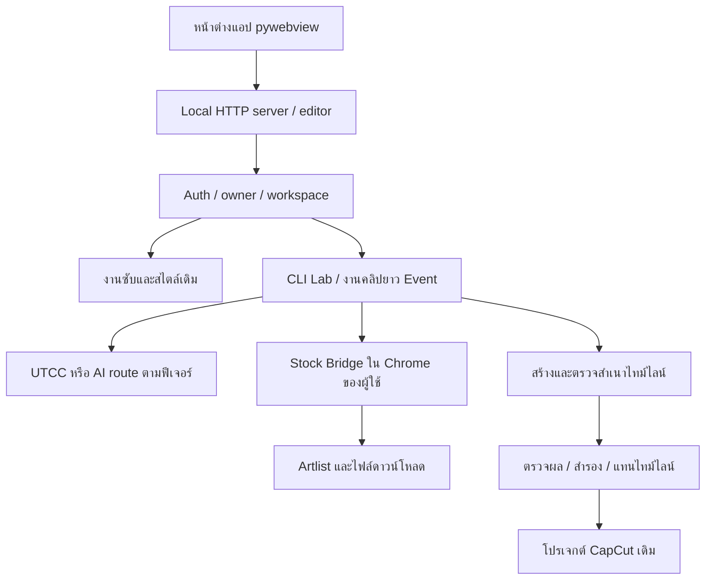

# โครงสร้างและแบบระบบ — ช่วยด้วยจ้า

อัปเดต: 28 ตุลาคม 2026 · ฐานซอร์ส/Release: **1.5.49**

เอกสารนี้อธิบายระบบที่มีอยู่จริงและหลักการที่ต้องรักษา อ่านคู่กับ `TASK_PHASES.md` ก่อนเริ่มงาน หากโค้ดไม่ตรงเอกสาร ให้ตรวจหลักฐานและแก้เอกสารในงานเดียวกัน ไม่ใช้เอกสารเก่าเป็นข้อยืนยันว่าฟังก์ชันยังใช้ได้

## 1. เป้าหมายผลิตภัณฑ์

แอปเดสก์ท็อปสำหรับผู้ใช้ทั่วไป ช่วยจัดซับและสไตล์ ตัดเรื่องจากคลิปยาว/หลายคลิป เพิ่ม B-roll เพลง และ Super Text แล้วนำผลกลับเข้าโปรเจกต์ CapCut เดิมอย่างกู้คืนได้ ผู้ใช้ควรทำงานผ่านแอปได้เอง ไม่ต้องเปิด Codex ในการใช้งานประจำ

เส้นทางหลัก: เลือกโปรเจกต์ → ใช้ Auto Caption ของ CapCut → เลือกรูปแบบ/ความยาว → วางแผน → ตรวจเรื่อง → สร้างผล → บันทึกและกลับหน้าหลัก CapCut → ใช้ผลกับโปรเจกต์เดิม → ตรวจภาพ/เสียงก่อนส่งออก

หลักด้านงานตัดต่อ: ยึดคำพูดจริง ซับสั้นหนึ่งบรรทัดเมื่อเหมาะสม ใช้ DB Heavent Blk และสไตล์/สีคณะจากระบบเดิม ซูมต่อเนื่องข้ามรอยตัด ภาพประกอบตรงประเด็น ไม่ซ้ำโดยไม่จำเป็น เพลงเข้ากับเนื้อหาและยาวครอบคลุมคลิป ไม่เปิดภาพคนพูดซ้อน B-roll โดยอัตโนมัติ เว้นแต่ผู้ใช้เลือก

## 2. สถาปัตยกรรม

เซิร์ฟเวอร์ฟังที่ `127.0.0.1` เริ่มพอร์ต 8765; ตัวเปิดแอปเลือกพอร์ตว่างได้ อย่าฝังพอร์ตเดียวในระบบเชื่อมต่อ และอย่าเปิดบริการออกเครือข่ายโดยไม่ออกแบบสิทธิ์เพิ่ม

| ส่วน | จุดเริ่มอ่าน/แก้ | หน้าที่ |
|---|---|---|
| เปิดแอป | `app/app_shell.py`, `app/ks/app_instance.py` | pywebview, backend, instance lock, self-test |
| โหมดเว็บ | `app/run.py`, `app/ks/server.py` | HTTP API, bind ผู้ใช้/โปรเจกต์, dispatch งาน |
| หน้าจอ | `app/ks/pages.py`, `editor_page.html`, `*_ui.py` | ประกอบ UI เดิมและแท็บเพิ่มเติม |
| สิทธิ์และ config | `auth.py`, `ce_config.py`, `ai_router.py` | ผู้ใช้, workspace, config และ route แยกฟีเจอร์ |
| ระบบเดิม | `core_engine.py`, `ce_features.py`, `ce_project.py`, `ce_timing.py` | ซับ สไตล์ โปรเจกต์ และ API ที่โค้ดเดิมเรียก |
| วางแผน/สร้างคลิป | `cli_lab.py`, `cli_lab_story.py`, `cli_lab_planning.py` | อ่านซับจริง ตรวจแผน จัดหลายช่วง และสร้างผลผ่าน CLI |
| งานคลิปยาว/Event | `event_clip.py`, `event_jobs.py`, `event_timeline.py` | วิเคราะห์หัวข้อ ช่วงผู้พูดที่กำหนด และแผนคลิปสั้น |
| Multicam/เสียง | `cli_lab_nested.py`, `cli_lab_alignment.py` | อ่าน draft ซ้อน สร้างเสียงสำหรับ align ซับเดิม |
| คำพูด/ซับ | `caption_roles.py`, `caption_resegment.py`, `text_layout.py` | แยกบทพูดจาก overlay และจัดท่อน/บรรทัด |
| งานภาพและข้อความ | `cli_lab_brand_style.py`, `cli_lab_typography.py`, `caption_style.py`, `timeline_motion.py`, `cli_lab_social.py`, `cli_lab_presentation.py` | สไตล์ร่วม ซูม keyframe ข้อความเน้นและจังหวะภาพ |
| B-roll ปกติ | `broll.py` | เสนอคำค้นอังกฤษ/ลิงก์ค้นหา; คนละเส้นทางกับดาวน์โหลดอัตโนมัติ |
| คลังสื่อ | `stock_accounts.py`, `stock_browser.py`, `stock_media.py`, `stock_project.py`, `stock_polish.py` | งานบัญชี/ดาวน์โหลด ตรวจไฟล์ จัดลงคลิป และปลายทางตามโปรเจกต์ |
| ส่วนขยาย | `app/stock_extension/` | Chrome Manifest V3; ทำงานบนเว็บที่ผู้ใช้ล็อกอิน |
| ระดับเสียง | `audio_levels.py`, `stock_polish.py` | วัด sample peak dBFS, เสียงพูดเป้าหมาย −4 และเพลง −18; ไม่ใช่ค่า fader หรือ LUFS |
| Webhook | `ce_ai.py`, `cli_lab_webhook.py`, `webhook_diagnostics.py` | เรียก AI รอผล/ยกเลิก และเก็บข้อมูลวินิจฉัยที่ไม่รวมเนื้อหา |
| งานเบื้องหลัง | `job_store.py`, `job_admission.py`, `feature_tasks.py`, `cli_progress_ui.py` | receipt แยกเจ้าของ งานชนกัน สถานะและ recovery |
| เขียน CapCut | `cli_lab_commit.py`, `apply_guard.py`, `capcut_session.py`, `unified_history.py` | ตรวจต้นทาง/สื่อ ล็อก สำรอง mirror rollback และประวัติ |
| แพ็ก/อัปเดต | `karaoke_studio_app.spec`, `release_package.py`, `publish_release.py`, `ks/updater.py`, `version.json` | runtime ฝังในแอป ZIP/hash GitHub และติดตั้งแทนตัวเดิม |
| เก็บไฟล์เก่า | `ks/storage_manager.py` | ตรวจสิ่งอ้างอิงและ cleanup ที่ย้อนกลับได้ |

ชื่อไฟล์ในตารางที่ไม่ขึ้นต้น `app/` อยู่ใต้ `app/ks/` ยกเว้นไฟล์แพ็ก/Release ซึ่งอยู่ใต้ `app/`

ข้อควรระวังในการ import: `core_engine.py` re-export โมดูลแบบไม่ใส่ `ks.` เพื่อรองรับโค้ดเดิม การเพิ่ม import ต้องไม่สร้าง config/state สองชุด ชุด self-test ตรวจ `core_engine.STATE is ce_config.STATE`

## 3. ข้อมูลและขอบเขตการเขียน

| ตำแหน่ง | ประเภท | ข้อปฏิบัติ |
|---|---|---|
| `app/ks/`, `app/stock_extension/`, `app/tests/` | ซอร์ส/ทดสอบ | แก้จากที่นี่ ไม่แก้ในไฟล์แอปที่ build แล้ว |
| `app/tools/` | Node, CapCut CLI, media runtime | dependency ที่แพ็กไปด้วย ไม่แก้ vendored code โดยไม่มีเหตุผลและหลักฐาน |
| `app/dist-*`, `app/build-*` | ผล build | สร้างใหม่ได้ เก็บเพียง 5 เวอร์ชันล่าสุดตามคำขอผู้ใช้ |
| `audits/` | หลักฐานทดสอบ/บางส่วนเป็นผลตัดต่อ | อ่านรายงานได้ ห้ามลบทั้งโฟลเดอร์เพียงเพราะเก่า; สื่ออาจยังถูกอ้างอิง |
| `media_library/` | สื่อในเครื่อง | อย่าลบหรือย้ายโดยไม่ตรวจการอ้างอิง |
| `~/.karaoke_studio/` | ข้อมูลผู้ใช้/เครื่อง | config, keys, sessions, stock pairing, receipts และ outputs; ห้ามใส่ Git หรือ Release |
| โปรเจกต์ CapCut ที่ผู้ใช้เลือก | งานจริงภายนอกซอร์ส | เขียนผ่าน guard/backup/transaction เท่านั้น |
| `release_repository/` | Git สำหรับข้อมูลอัปเดต | ณ วันที่บันทึก Git ติดตามเฉพาะ `version.json`; ไม่ใช่ที่เก็บซอร์สแอปทั้งหมด |
| `motion-intro/`, `test-mcp-0.1/` | งาน/ทดลองแยก | ไม่ใช่ backend หลัก อ่านคำสั่งเฉพาะโฟลเดอร์ก่อนแตะ |

receipt แยกตาม hash ของเจ้าของและชนิดงาน (`cli`, `event`, `stock`, `plans`, `installs`, `results`) งานที่โปรเซสเก่าหยุดกลางทางไม่ควรถูกเริ่มเขียนต่อเอง ข้อมูลลับใช้กลไกไฟล์ส่วนตัวเดิม ไม่ฝัง credential ของผู้พัฒนาในแอปแจก

## 4. สัญญาระหว่างขั้นตอน

### 4.1 วางแผน

- CLI Lab ยึดซับพร้อมเวลาของ CapCut ไม่สร้างบทถอดเสียงใหม่แทนที่โดยเงียบ ๆ
- โหมดจัดเรื่องรับความยาวเป้าหมาย 5–600 วินาที ตาม `cli_lab_limits.py`; ไม่ได้หมายความว่าต้นฉบับยาวได้เพียง 10 นาที
- โหมดหลายช่วงตรวจช่วงซับจริง ความยาวรวม การซ้อน และ coverage ของแหล่งต้นฉบับ มีการขอปรับแผนเมื่อ validation ไม่ผ่าน
- แผนก่อนสร้างผลยังมีอายุ 1 ชั่วโมงและผูกกับ hash ต้นทางใน `cli_lab.py` อย่าสับสนกับรายการนำเข้าผลที่สร้างเสร็จแล้ว
- คำขอ CLI planning และ B-roll ผ่าน Webhook wrapper รอสูงสุด 300 วินาทีต่อคำขอ ไม่ใช่เวลารวมทั้งงานที่อาจปรับแผนหลายรอบ
- เมื่อ read timeout ไม่ส่ง POST ซ้ำอัตโนมัติ เพราะเซิร์ฟเวอร์อาจยังทำงานอยู่ การยกเลิกต้องไม่รับผลช้ามาแก้โปรเจกต์

ในซอร์ส P0.6 โหมดส่งเสียง Webhook `auto` เลือก JSON เพียงครั้งเดียวต่อการลองรูปแบบ ไม่ fallback เป็น multipart เมื่อ timeout หรือได้รับ ack; ผู้ใช้ยังเลือก multipart โดยตรงได้

### 4.2 สร้างผลและตกแต่ง

ทำในสำเนา/staging ตรึงข้อมูลต้นทาง ตรวจ hash ก่อนส่งผลสำเร็จ สื่อที่โหลดต้องผ่านตรวจชนิด ขนาด ระยะเวลา และไม่ใช่ preview/watermark ข้อความเน้นต้องสัมพันธ์กับคำพูดจริง; keyword stock ใช้ภาษาอังกฤษ คำอธิบายบนจอเป็นไทยได้

ตั้งแต่ 1.5.49 เสียงพูดวัดจากเสียงรวมที่เปิดใช้งานแล้วปรับพีกเป้าหมาย −4 dBFS (ช่วง −6 ถึง −2) คง mute และกราฟเดิมไว้ เพลงเตรียมเป็น lossless WAV พีก −18 dBFS ก่อน fade ไม่ duck ลดซ้ำตามเสียงพูด หากเสียงพูดเบาจนชนเพดาน gain ของ CapCut ให้รายงานว่าไม่ถึงเป้า ไม่อ้างว่าปรับสำเร็จจากค่าตั้งอย่างเดียว แคช B-roll ใช้คำสำคัญภาพที่ตรงชื่อสื่อและตรวจ hash ได้ แม้ query ไม่ตรงทุกตัว โดยยังเคารพ exclude URL/hash

การ align ใน CLI Lab ใช้คำจากซับเดิม โมเดลเสียงในเครื่องช่วยจับเวลา ไม่ใช่การอนุญาตให้เพิ่มระบบถอดเสียงใหม่ทุกเส้นทาง งานหลายกล้อง/compound ยังต้องทดสอบตามชนิด draft จริง ไม่เหมารวมว่ารองรับทุก schema

### 4.3 นำผลเข้าโปรเจกต์

`preview` ตรวจผลและออก ticket → `commit` ตรวจ owner/project/active timeline, source/output hash และ media stamps → ตรวจ CapCut ไม่อยู่หน้าตัดต่อ → สำรอง → เขียน mirror ที่สอดคล้องกัน → rollback หากเขียนไม่ครบ → consume ticket

ตั้งแต่ 1.5.48 **ticket นำเข้าผลไม่มีการหมดอายุเพราะเวลา** และบันทึกเป็น receipt ส่วนตัว แต่ไฟล์เปลี่ยน/ผิดโปรเจกต์ยังต้องหยุดตรวจใหม่ การมี receipt ไม่ได้หมายความว่า UI คืนหน้าทั้งหมดหลังปิดแอปได้สมบูรณ์แล้ว ผลจากรุ่นก่อนอัปเดตที่ ticket หาย ใช้ “เตรียมนำคลิปเข้าอีกครั้ง” โดยไม่ต้องตัดใหม่

การแก้ซอร์ส P0.6 (ยังไม่แพ็ก/เผยแพร่): `event_timeline.mirror_updates` เป็นรายการ mirror ร่วมสำหรับซับ, Event, resegment, proofread และ CLI import ตรวจ ID/โครงสร้างก่อนเขียน ไม่เปลี่ยน pristine backup; ตรวจไฟล์อีกครั้งก่อน transaction และคง rollback เดิม

`cli_results.py` เก็บผลสร้างเสร็จตาม owner/project พร้อม source/output hash และ media stamps ตั้งแต่สร้างผล UI แสดงรายการผลที่รอนำเข้าหลังเปิดใหม่ การเลือกผลตรวจ fingerprint เดิมก่อนออก ticket และไม่ refresh ต้นฉบับโดยเงียบ ๆ; receipt นำเข้ารุ่นก่อนถูกนำมาใช้พร้อม fingerprint เดิม ผลที่นำเข้าแล้วถูกทำเครื่องหมาย imported แยกจากงาน running/failed และไม่หมดอายุเพราะเวลา กรณี job_not_found เป็นข้อผิดพลาดถาวรสำหรับ UI แต่ offline/401 ยังเก็บงานไว้

### 4.4 บัญชี stock

ผู้ใช้ล็อกอินบัญชีของตัวเองใน Chrome และเชื่อม Stock Bridge เฉพาะเครื่อง แอปไม่รับรหัสผ่าน/คุกกี้เพื่อแจกไปเครื่องอื่น Artlist อัตโนมัติผ่านเว็บจริงจึงขึ้นกับหน้าเว็บ สมาชิกและสิทธิ์ดาวน์โหลด **Envato ยังไม่ใช่เส้นทางดาวน์โหลดอัตโนมัติที่รองรับ** แม้มีหน้าเชื่อมบัญชี/ลิงก์ค้นหา ไม่มีหลักฐานว่าใช้ Artlist MCP ในโค้ดนี้

### 4.5 อัปเดตและแจกจ่าย

แพ็ก runtime → self-test/ตรวจ signature → ZIP + SHA-256 + size → Release → ดาวน์โหลดไฟล์สาธารณะตรวจซ้ำ → อัปเดต manifest เป็นขั้นสุดท้าย Installer ใช้ตำแหน่งติดตั้งเดิมและสำรอง ห้ามหยุดงานที่กำลังรันเพื่อเปลี่ยนแอปโดยไม่ตรวจสถานะก่อน รุ่นปัจจุบันยังมีความเสี่ยงจาก ad-hoc signing/TCC บน macOS; ยังไม่ถือว่าติดตั้งครั้งแรกและอัปเดตทุกเครื่องผ่านแล้ว

การเก็บแพ็กเก่าในซอร์ส P0.6 ใช้นโยบาย 5 รุ่นล่าสุด รวมการป้องกันรุ่นปัจจุบัน/โปรเซสที่กำลังเปิด รองรับ dist/build ที่มี -final ตรวจสื่ออ้างอิงก่อน preview และ move; ย้ายเข้า `~/.Trash/Chuaydai-builds/<root-hash>/<ticket>` พร้อม manifest และ rollback กู้รายการ `.cleanup_trash` เดิมได้ ไม่ล้าง Trash อัตโนมัติ หากตรวจโปรเซส/สื่อไม่ได้ให้หยุด ไม่ข้าม guard

## 5. หลักฐานฐานปัจจุบันและข้อจำกัด

| สิ่งที่ตรวจแล้ว | หลักฐานใน workspace |
|---|---|
| 1.5.49: 393 tests; สำเนาโปรเจกต์ปัจจุบันใส่ B-roll 4 ช็อต พีกพูด −4.0 และเพลง −18.0; import มี backup | `audits/stock-audio-1.5.49/` (ยังต้องตรวจ playback ใน CapCut) |
| 1.5.48: 390 Python tests + UI recovery + packaged self-test/signature | `audits/import-review-1.5.48/` |
| 1.5.47: แชท 12.88 วินาที, B-roll 130.56 วินาที, planning 118.36 วินาทีรวมปรับแผนหนึ่งรอบ | `audits/ai-diagnostics-1.5.47/live-comparison.json`, `live-plan.json` |
| Release 1.5.48 ตรวจ public download และ manifest แล้ว | `audits/update-release-1.5.48.json`, `audits/import-review-1.5.48/publish.txt` |
| เก็บ 1.5.44–1.5.48; ย้ายรุ่นเก่าลง Trash | `audits/version-cleanup-2026-10-28/receipt.json` |

ผลบนเครื่องพัฒนาไม่ยืนยันว่าสาเหตุ timeout ของเครื่องอื่นหายแล้ว รายงาน Webhook เก็บ metadata เฉพาะรอบเปิดแอป ไม่เก็บ prompt/ซับ/credential/full URL ให้เก็บหลังเกิดปัญหาก่อนปิดแอป

เอกสารเดิมเช่น `app/CLI_LAB_GUIDE.md`, `README_APP.md`, `stock_extension/README.md` มีข้อมูลประวัติและข้อจำกัดเก่า อย่าถือเลขรุ่น/timeout/ความยาวจากเอกสารเหล่านั้นเหนือโค้ดและหลักฐานปัจจุบัน งานปรับคู่มืออยู่ในแผน Phase 5

## 6. Definition of Done ของฟีเจอร์

โค้ดและ UI ทำงานร่วมกัน → validation/ข้อผิดพลาดบอกทางไปต่อ → ทดสอบเส้นทางสำเร็จ ล้มเหลว ยกเลิก และกู้คืนตามความเสี่ยง → การเขียนงานจริงมีสำรองและ rollback → ตรวจผลใน CapCut เมื่อกระทบภาพ/เสียง → แพ็กและตรวจบนเครื่องเป้าหมายเมื่อกระทบการแจก → อัปเดตเอกสาร/หลักฐาน ห้ามเรียก “พร้อมทุกเครื่อง” จาก unit test หรือไฟล์ draft อย่างเดียว
